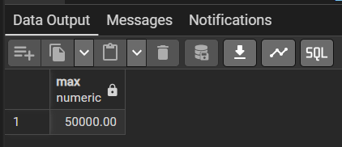
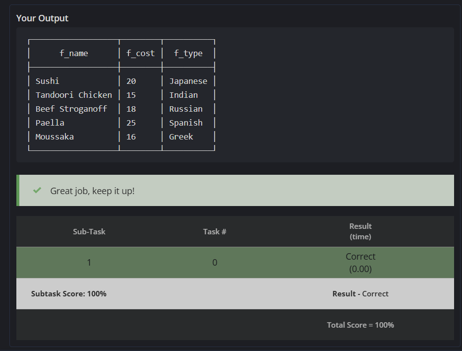
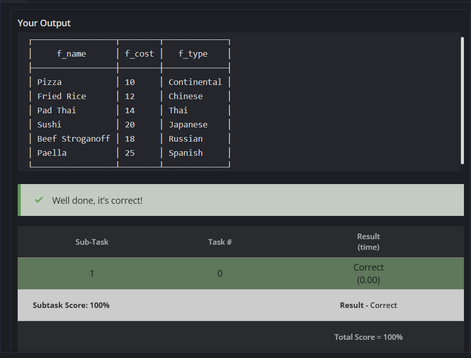

# EXP 10 — SQL Subqueries

## Aim
To practice SQL subqueries using an employee table and related food/rating tables.

## Exercises

### 10.1 — Find the 2nd and 3rd Highest Salary

The following queries use nested subqueries and `MAX()` to find distinct salary levels.

#### (a) Second-highest salary

```sql
SELECT MAX(salary)
FROM employee
WHERE salary < (SELECT MAX(salary) FROM employee);
```

**How it works**
1. The inner query finds the highest salary in `employee`.
2. The outer query considers only salaries lower than that maximum.
3. `MAX(salary)` over those remaining rows returns the second-highest salary value.

#### (b) Third-highest salary

```sql
SELECT MAX(salary)
FROM employee
WHERE salary < (
    SELECT MAX(salary)
    FROM employee
    WHERE salary < (SELECT MAX(salary) FROM employee)
);
```

**How it works**
1. The innermost query finds the highest salary.
2. The next query finds the highest salary below the overall maximum — the second-highest distinct salary.
3. The outer query finds the highest salary below the second-highest value — the third-highest distinct salary.

> **Note:** These queries return the second- and third-highest *distinct salary values*. If the table has fewer than two or three distinct salary values, the corresponding result is `NULL`.

#### Screenshot — Exercise 10.1



---

### 10.2 — Food Items Costing More Than the Average

**SQL query** (from the exercise file):

```sql
SELECT f_name, f_cost, f_type
FROM food
WHERE f_cost > (SELECT AVG(f_cost) FROM food);
```

**Explanation**
- The subquery calculates the average cost across all rows in `food`.
- The outer query returns the name, cost, and type of each food item whose cost is greater than that average.

**Reference:** [CodeChef SQL Intermediate — GSQ71](https://www.codechef.com/learn/course/sql-intermediate/SQ00BS04/problems/GSQ71)

#### Screenshot — Exercise 10.2



---

### 10.3 — Food Items With a Rating of 4 or Higher

**SQL query** (from the exercise file):

```sql
SELECT f_name, f_cost, f_type
FROM food
WHERE f_id IN (
    SELECT f_id
    FROM ratings
    WHERE f_rating >= 4
);
```

**Explanation**
- The subquery selects food IDs from `ratings` where `f_rating >= 4`.
- `IN` checks which rows in `food` have an ID included in that result.
- The query displays the matching food name, cost, and type.

**Reference:** [CodeChef SQL Intermediate — GSQ74](https://www.codechef.com/learn/course/sql-intermediate/SQ00BS04/problems/GSQ74?tab=statement)

#### Screenshot — Exercise 10.3



---

## Files in This Experiment

| File | Description |
|---|---|
| `README.md` | Experiment description, SQL queries, explanations, and embedded output screenshots |
| `10.1.png` | Screenshot for the second- and third-highest salary subqueries |
| `10.2.png` | Screenshot for the average food-cost subquery |
| `10.3.png` | Screenshot for the rating subquery |

## Concepts Practiced

- Scalar and nested subqueries
- Aggregate functions: `MAX()` and `AVG()`
- Filtering rows using `WHERE`
- Comparing values against a subquery result
- Filtering by a set of IDs using `IN`
- Querying related data across `food` and `ratings` tables

## How to View the Screenshots on GitHub

Keep `README.md` and all three PNG files in the same `EXP10` folder. The relative image paths in this README (`./10.1.png`, `./10.2.png`, and `./10.3.png`) allow GitHub to render the screenshots directly in the README.

## Conclusion

This experiment demonstrates how subqueries can be used to calculate salary ranks, compare food prices against an average, and filter food items using rating data.
